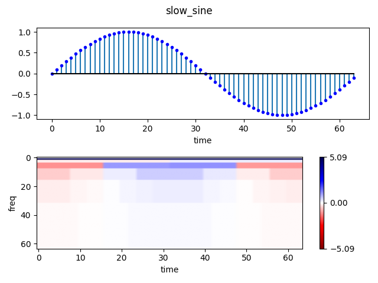

# Haar DWT visualization
## by Christos Faloutsos, Nov. 2025

## Goal
Computes the DWT of the given input file and plots its scalogram.
If no file is given, it create a few waveforms and plots their scalograms.

## Installation
With 'uv' installed:
https://docs.astral.sh/uv/getting-started/installation/
```commandline
git clone ....
chmod u+x scalogram.py
```

Without 'uv'
```commandline
git clone ...
python3 -m venv .venv
source .venv/bin/activate
pip install -r requirements.txt
python3 scalogram.py 
```


## USAGE - basic
We assume 'uv' is installed - then

a) To see a demo of several waveforms (square, sine, flip-flop, etc):
```commandline
uv run scalogram.py
```
or just
```commandline
  ./scalogram.py
```

b) To apply it on **your_file_name.csv**
(which should have one number per line, no header):
```commandline
uv run scalogram.py -f your_file_name.csv
```
or
```commandline
./scalogram.py -f your_file_name.csv
```

## USAGE - more details
A) To see the available flags
```commandline
uv run scalogram.py --help
```
B) for more examples
```commandline
git clone  ....
make demo_all
```

## USAGE - flags
```commandline
   --help                       # obvious
-d --duration INT               # creates signals of that length
-f --file_name filename.csv     # operates on filename.csv
-v --verbose                    # verbose: prints diagnostics
-a --abs_flag                   # uses the absolute value 
                                #    of the DWT coefficients
-p --print_flag                 # prints the plots into png
```

## Sample output
